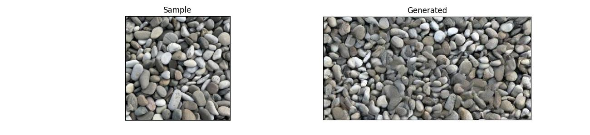
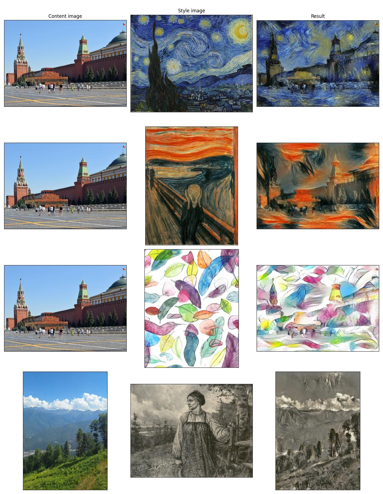

**Реализация алгоритма нейросетевого переноса стиля**

Автор: Елизаров Никита, студент 3-го курса бакалавриата ФПМИ МФТИ

Цель данного проекта - изучить статью ['Image Style Transfer Using Convolutional Neural Networks \[Gatys et al. 2016\]'](https://www.cv-foundation.org/openaccess/content_cvpr_2016/papers/Gatys_Image_Style_Transfer_CVPR_2016_paper.pdf). В статье изложен алгоритм нейросетевого переноса стиля, то есть решается задача переноса на произвольное изображения стиля картины какого-нибудь художника, что определенно звучит интересно. Результаты статьи заинтересовали меня. Алгоритм основан на использовании сверточной сети, обученной для задачи распознавания объекта на фотографии. Авторы использовали VGG-19.

Вся основная работа выполнялась в ноутбуках, которые находятся в директории *research_notebooks* (см. дополнительно README в той директории). Я хотел не только написать код, который будет работать, но и понять все решения авторов. Я объяснил, зачем нужна нормализованная VGG, почему формула лосса стиля именно такая, почему используются какие-то слои, параметры лосса и прочее. Мною был изучен каждый аспект реализации. Многое было проверено эмпирическим путем. Дополнительно задавал себе вопросы, которые не затрагивали авторы статьи.

Одновременно с этим по ходу решения этой задачи мне пришлось изучить еще одну статью, лежащую в основе переноса стиля, - статью о генерации текстуры по примеру ['Texture Synthesis Using Convolutional Neural Networks \[Gatys et al. 2015\]'](https://arxiv.org/abs/1505.07376).

Для общего использования я подготовил простые консольные программы, чтобы можно было делать генерации без написания кода. Они называются в репозитории *style_transfer_app* и *texture_synthesis_app*.

**Результаты генерации текстуры**

**Результаты переноса стиля**

**Инструкция по запуску приложений**
1. Склонируйте репозиторий на свое устройство
2. Переключитесь на ветку dev
3. Создайте виртуальное окружение с помощью: python3 -m venv venv/
4. Активируйте его: source venv/bin/activate
5. Установите зависимости: python -m pip install -r requirements.txt
6. Для запуска нужного приложения выполните: python3 style_transfer_app или python3 texture_synthesis_app